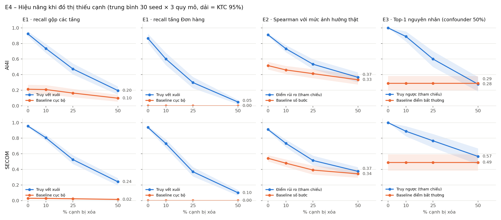
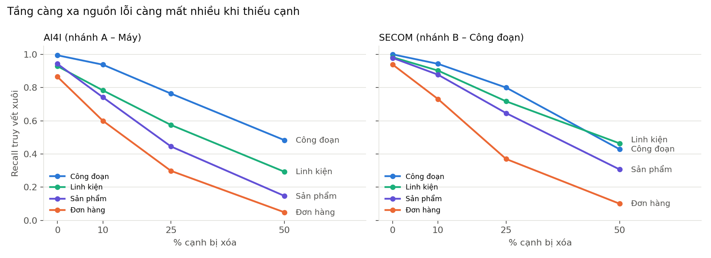

# P3 – Đồ thị, Bộ sinh kịch bản, Truy vết xuôi: báo cáo hoàn thành

*Ngày 11/10/2026 · 2.160 kịch bản · 30 seed × 2 domain × 3 quy mô × 3 tỷ lệ confounder × 4 tỷ lệ xóa cạnh*

## 1. Trạng thái công việc

| ID | Việc | Trạng thái | Output |
|---|---|---|---|
| P3.1 | Ontology + schema graph | ✅ | `docs/ontology.md`, `d3p3/ontology.py`, `schemas/*.schema.json` + mẫu đã kiểm bằng jsonschema |
| P3.2 | Sinh graph độc lập lỗi | ✅ | `generate_graph(seed, size)` cho small/medium/large; `docs/sim_params.md` |
| P3.3 | Gán AI4I/SECOM, tiêm nhiễu | ✅ | `assign_data()`, `inject_confounders(0/25/50%)` |
| P3.4 | Bộ sinh kịch bản | ✅ | `generate_scenario(seed, config)` → graph_full, graph_observed, incidents, forward_truth, backward_truth, true_impact; 17 unit test đạt |
| P3.5 | Truy vết xuôi | ✅ | `forward_trace()` theo tầng + đường đi; ra đúng `M05 → P02 → A13 → X1 → O43/O58`; chạy cả 2 nhánh |
| P3.6 | Baseline E1 | ✅ | `baseline_e1()` |
| P3.7 | Chạy E4 | ✅ (E1 đủ; E2/E3 dùng bản tham chiếu) | `results/results_p3.csv`, `results/summary_p3.md`, 2 hình |
| P3.8 | Export JSON cho dashboard | ✅ (làm sớm) | `export.graph_to_json()`, `schemas/samples/demo_M05_graph_with_impact.json` |
| P3.9 | Slide | ⏳ ngày 9 | – |

## 2. Dữ liệu dùng (đếm trực tiếp từ file)

- **AI4I 2020**: 10.000 dòng, 339 `Machine failure` (TWF 46, HDF 115, PWF 95, OSF 98, RNF 19). Cần lưu ý cho P1: **chỉ 1/19 dòng RNF có `Machine failure = 1`**; 9 dòng lỗi không có cờ chế độ nào; 24 dòng có nhiều cờ. Bộ sinh kịch bản chọn chế độ nặng nhất (PWF > HDF > OSF > TWF > RNF), không cờ → `UNK`. Do đó hầu như không có kịch bản gốc RNF.
- **SECOM**: 1.567 dòng, 104 fail, 590 cảm biến, thời gian 08/01/2008 → 10/12/2008. Chia theo thời gian nên **test chỉ có 14 fail** → các kịch bản SECOM dùng lại 14 dòng lỗi này (cấu trúc đồ thị và gốc vẫn khác nhau theo seed).
- Thư mục Drive `data/` đang trống, nên dữ liệu lấy từ bản sao công khai trên GitHub và đối chiếu: AI4I khớp đúng số liệu gốc UCI; SECOM giống hệt nhau giữa 3 bản sao độc lập (CSV gộp và `secom.data` gốc).

## 3. Kết quả chính

### E1 – Truy vết xuôi vs. cảnh báo cục bộ (đồ thị đầy đủ)

| Recall gộp các tầng | Truy vết xuôi | Baseline cục bộ |
|---|---|---|
| AI4I | **0.92 ± 0.15** (precision 0.85) | 0.21 ± 0.28 |
| SECOM | **0.96 ± 0.07** (precision 0.96) | 0.03 ± 0.05 |

Baseline cục bộ chỉ thấy công đoạn liền kề nên recall linh kiện / sản phẩm / đơn hàng = 0. Truy vết xuôi tìm đúng 86% (AI4I) và 94% (SECOM) đơn hàng bị ảnh hưởng thật. Thời gian chạy < 1 ms/sự cố kể cả đồ thị large.

### E4 – Khi đồ thị thiếu cạnh

| Chỉ số (trung bình 2 domain × 3 quy mô) | Đầy đủ | Thiếu 10% | Thiếu 25% | Thiếu 50% |
|---|---|---|---|---|
| E1 recall gộp | 0.94 | 0.77 (−18%) | 0.50 (−47%) | 0.22 (−77%) |
| E1 recall **đơn hàng** | 0.90 | 0.67 (−26%) | 0.34 (−63%) | **0.08 (−92%)** |
| E2 Spearman (tham chiếu) | 0.91 | 0.73 (−20%) | 0.52 (−43%) | 0.37 (−59%) |
| E3 top-1, confounder 50% (tham chiếu) | 1.00 | 0.91 | 0.69 | 0.43 |




### Đối chiếu tiêu chí thành công trung thực (mục 15.5)

1. **E1 vẫn hơn baseline ở mọi mức thiếu cạnh**, nhưng giá trị tuyệt đối sụp mạnh: thiếu 25% cạnh thì chỉ còn tìm được khoảng 1/3 đơn hàng bị ảnh hưởng, thiếu 50% còn dưới 1/10. Tầng càng xa nguồn lỗi càng mất nhiều, vì một đường Máy → Đơn hàng có 4 cạnh và chỉ cần mất 1 cạnh là đứt (xác suất còn nguyên ≈ (1 − p)⁴: 0.32 khi p = 25%).
2. **Lỗi im lặng:** precision vẫn cao (0.85–1.0) khi thiếu cạnh, tức là hệ thống *bỏ sót* chứ không *báo sai*. Kỹ sư sẽ thấy danh sách ảnh hưởng "sạch" mà không biết nó thiếu. Đây là rủi ro lớn nhất khi chạy trên dữ liệu Denso.
3. **E2 (bản tham chiếu)** hơn baseline số bước rõ rệt tới 25% thiếu cạnh; ở 50% hai cách gần như ngang nhau (0.37 vs 0.33–0.34).
4. **E3 (bản tham chiếu)**: ở AI4I thiếu 50% cạnh, top-1 = 0.28, **không hơn** baseline điểm bất thường (0.29). SECOM vẫn hơn (0.58 vs 0.41).
5. Lưu ý thiết kế: E3 trên đồ thị đầy đủ luôn đạt 1.0 vì confounder được định nghĩa là "không phải tổ tiên của kết quả xấu" (mục 18.3), nên đồ thị đầy đủ loại chúng ngay. Để E3 khó hơn, P1 nên chạy thêm với `background_fp=True` (thêm cảnh báo sai của detector, có thể là tổ tiên).

### Thiếu loại quan hệ nào thì hại nhất? (thiếu 25% từng loại, medium)

| Loại cạnh bị thiếu | Recall đơn hàng AI4I | Recall đơn hàng SECOM |
|---|---|---|
| không thiếu | 0.83 | 0.94 |
| `used_in` (BOM) | **0.58** | 0.78 |
| `fulfills` (đơn hàng ↔ sản phẩm) | **0.59** | **0.70** |
| `produces` (công đoạn → linh kiện) | 0.66 | 0.75 |
| `operates_in` (máy → công đoạn) | 0.70 | 0.94 |
| `feeds` (công đoạn → công đoạn) | 0.81 | 0.94 |

**Gợi ý cho triển khai Denso:** ưu tiên lấy đủ **BOM**, **dòng đơn hàng – sản phẩm** và **routing công đoạn → linh kiện** trước; quan hệ công đoạn nối tiếp ít ảnh hưởng nhất.

## 4. Hạn chế phải nêu thẳng

- Đồ thị nhà máy, trọng số, tồn kho, ưu tiên, hạn giao là **mô phỏng** (docs/sim_params.md); kết quả chưa chứng minh trên dữ liệu Denso.
- Ground truth và hệ thống dùng **cùng dạng** mô hình lan truyền (noisy-OR); điểm khác chỉ là trọng số nhiễu, tồn kho nhiễu, WIP buffer ẩn và cạnh bị thiếu. Kết quả trên đồ thị đầy đủ vì vậy là **cận trên**. Khi có `true_impact` của P2 với cơ chế khác, cần chạy lại E1/E2.
- Cạnh bị xóa **ngẫu nhiên đều**; dữ liệu thật thường thiếu có hệ thống (cả một loại quan hệ, cả một line), phụ lục theo loại cạnh chỉ phản ánh một phần.
- Detector trong `data.py` là **mock** để pipeline chạy được. Ở ngưỡng recall 90% trên validation: AI4I báo sai 37% (test), SECOM báo sai 92% → Isolation Forest không giám sát gần như không tách được SECOM. P2 cần xử lý; điều này không ảnh hưởng E1/E4 vì truy vết xuôi xuất phát từ sự cố đã biết.
- E2/E3 trong bảng là **bản tham chiếu** của P3 (`d3p3/reference.py`), không phải kết quả chính thức của P4/P1.

## 5. Bàn giao cho các thành viên

| Người | Dùng gì | Cần làm |
|---|---|---|
| **P1** (backward) | `sc["incidents"]`, `sc["bad_outcome"]`, `sc["graph_observed"]`, thuộc tính node `hist_fail_rate` (chỉ từ train) | Viết `backward_trace(graph_observed, incidents, bad_outcome)` trả list `{node_id, score, …}` xếp giảm dần, thay `backward_trace_ref` trong `scripts/run_experiments_p3.py`. Thay detector mock bằng model AI4I (ghi đè cột `anomaly_score`/`detected` hoặc sửa `load_ai4i`). |
| **P2** (true_impact, SECOM) | `d3p3/truth.py` (bản tham chiếu) | Kiểm tra/thay `true_impact(graph_full, root, severity)` giữ chữ ký; thay detector SECOM. |
| **P4** (risk, action) | Output `forward_trace()` theo `schemas/forward_trace.schema.json`; node Order có `priority`, `due_in_days`; Máy có `alt_machines`, `spare_capacity`; Linh kiện có `safety_stock`, `daily_usage`, `lead_time_days`, `n_alt_sources` | Viết `risk_score(trace, graph)` thay `risk_score_ref`; baseline E2 có sẵn `baseline_e2`. |
| **P5** (runner, dashboard) | `results/results_p3.csv` (dạng dài: experiment, domain, size, seed, confounder_ratio, edge_drop, method, layer, metric, value); `schemas/samples/demo_M05_graph_with_impact.json` | Gộp vào results.csv chung; dashboard đọc node-link JSON (`affected`, `est_impact`, `on_impact_path`). |

## 6. Chạy lại

```bash
pip install numpy pandas networkx scikit-learn scipy matplotlib tabulate pytest
python -m pytest -q tests                         # 17 test
python scripts/make_samples.py                    # demo M05 + mẫu schema
python scripts/run_experiments_p3.py --seeds 30   # ~2,5 phút, 2.160 kịch bản
python scripts/run_edge_type_sensitivity.py
python scripts/summarize_p3.py                    # bảng + hình
```
